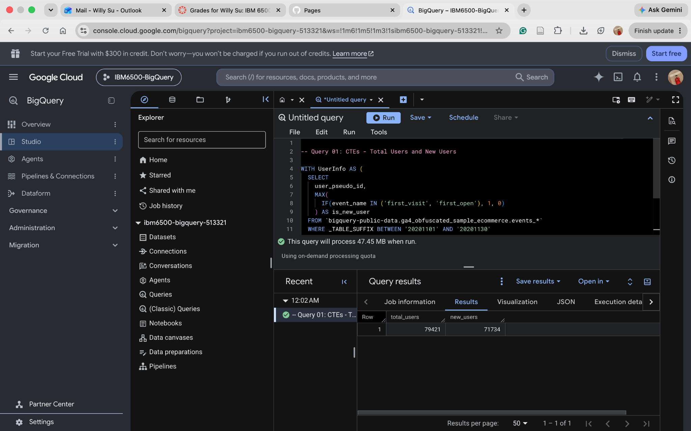
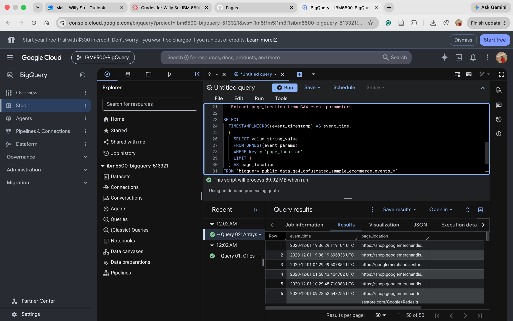
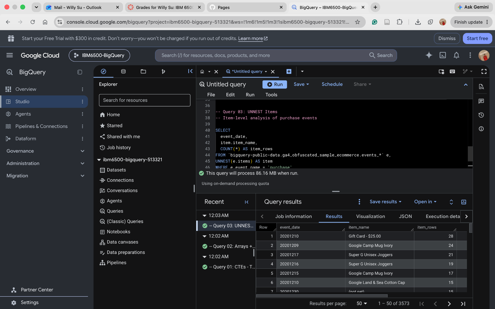
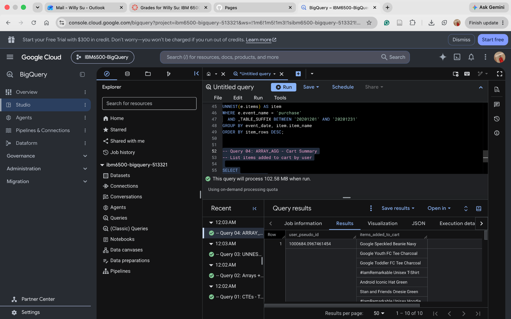
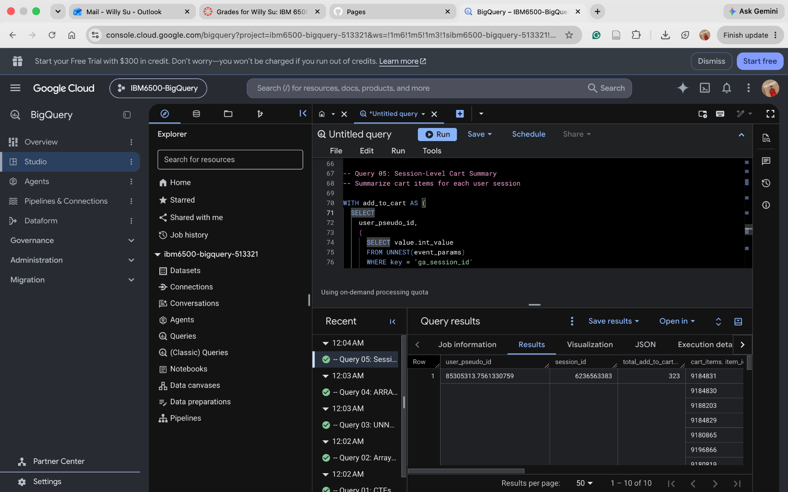
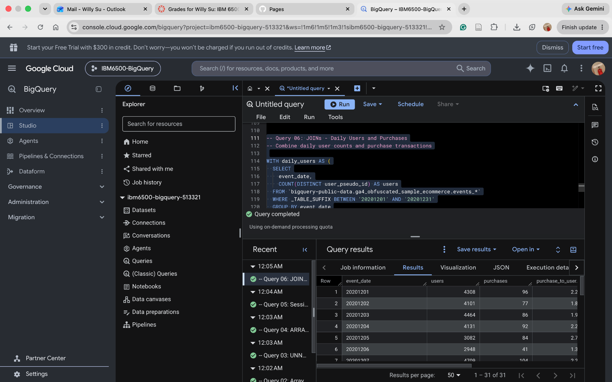
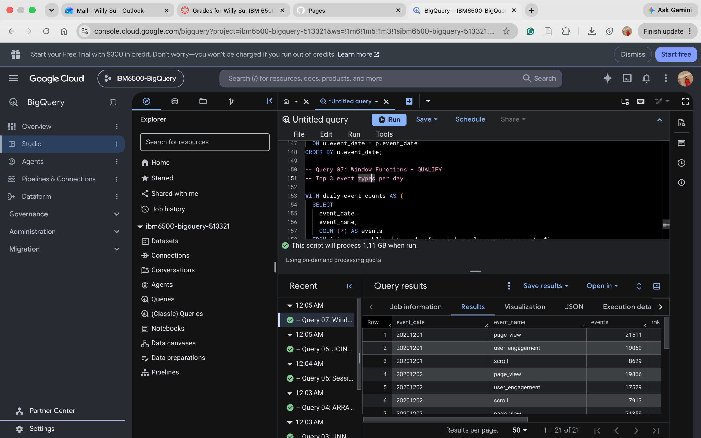
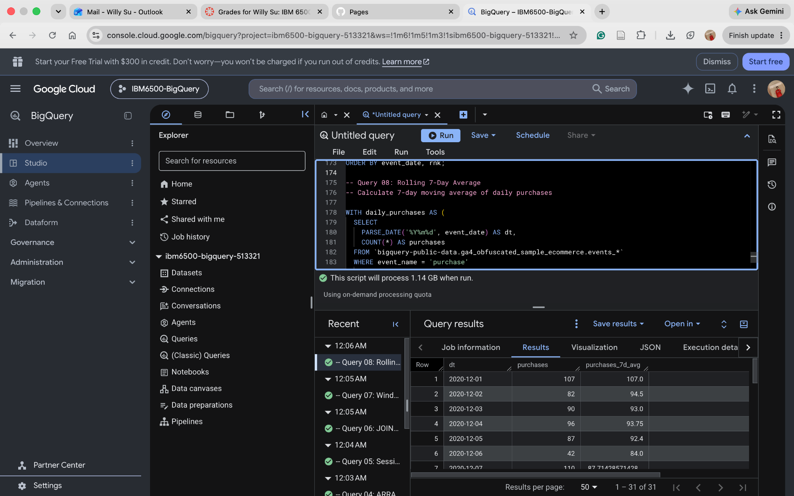
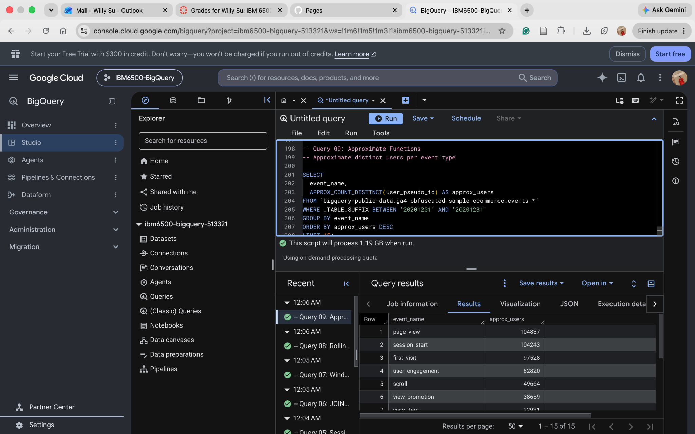

## Overview

**Dataset:** `bigquery-public-data.ga4_obfuscated_sample_ecommerce.events_*`\
**Environment:** Google BigQuery (SQL)\
**Source file:** `W05 BigQuery SQL Lecture 2.sql`

> **Results note:** Interpretations are based on the SQL logic and the BigQuery results visible in the provided screenshots.

## Query 01: CTEs — Total Users and New Users

**Purpose.** Creates a user-level CTE, flags users with first_visit or first_open, and counts all users and flagged new users.

**SQL code**

``` sql
-- Query 01: CTEs - Total Users and New Users

WITH UserInfo AS (
  SELECT
    user_pseudo_id,
    MAX(
      IF(event_name IN ('first_visit', 'first_open'), 1, 0)
    ) AS is_new_user
  FROM `bigquery-public-data.ga4_obfuscated_sample_ecommerce.events_*`
  WHERE _TABLE_SUFFIX BETWEEN '20201101' AND '20201130'
  GROUP BY user_pseudo_id
)
SELECT
  COUNT(*) AS total_users,
  SUM(is_new_user) AS new_users
FROM UserInfo;
```

**BigQuery screenshot**

{fig-alt="BigQuery results for Query 1" width="100%"}

**Result and interpretation.** The November 2020 query returned 79,421 total users and 71,734 new users in the earlier BigQuery result screenshot. The new-user flag follows the event-based definition in this query.

## Query 02: Arrays and UNNEST — Page Location

**Purpose.** Extracts the page_location parameter from nested GA4 event_params for page_view events.

**SQL code**

``` sql
-- Query 02: Arrays + UNNEST
-- Extract page_location from GA4 event parameters

SELECT
  TIMESTAMP_MICROS(event_timestamp) AS event_time,
  (
    SELECT value.string_value
    FROM UNNEST(event_params)
    WHERE key = 'page_location'
    LIMIT 1
  ) AS page_location
FROM `bigquery-public-data.ga4_obfuscated_sample_ecommerce.events_*`
WHERE event_name = 'page_view'
  AND _TABLE_SUFFIX BETWEEN '20201201' AND '20201202'
LIMIT 50;
```

**BigQuery screenshot**

{fig-alt="BigQuery results for Query 2" width="100%"}

**Result and interpretation.** Returns up to 50 page-view event timestamps and associated page URLs for December 1–2, 2020. The URL is a page-level attribute rather than a separate top-level column.

## Query 03: UNNEST Items — Purchase Item Counts

**Purpose.** Expands each purchase event’s items array into item-level rows and groups counts by date and product name.

**SQL code**

``` sql
-- Query 03: UNNEST Items
-- Item-level analysis of purchase events

SELECT
  event_date,
  item.item_name,
  COUNT(*) AS item_rows
FROM `bigquery-public-data.ga4_obfuscated_sample_ecommerce.events_*` e,
UNNEST(e.items) AS item
WHERE e.event_name = 'purchase'
  AND _TABLE_SUFFIX BETWEEN '20201201' AND '20201231'
GROUP BY event_date, item.item_name
ORDER BY item_rows DESC;
```

**BigQuery screenshot**

{fig-alt="BigQuery results for Query 3" width="100%"}

**Result and interpretation.** The earlier BigQuery result showed 3,573 grouped rows. item_rows counts expanded item records, not necessarily the number of units sold.

## Query 04: ARRAY_AGG — Cart Summary

**Purpose.** Aggregates item names added to cart into an array for each user.

**SQL code**

``` sql
-- Query 04: ARRAY_AGG - Cart Summary
-- List items added to cart by user

SELECT
  user_pseudo_id,
  ARRAY_AGG(item.item_name) AS items_added_to_cart
FROM `bigquery-public-data.ga4_obfuscated_sample_ecommerce.events_*` e,
UNNEST(e.items) AS item
WHERE e.event_name = 'add_to_cart'
  AND _TABLE_SUFFIX BETWEEN '20201201' AND '20201231'
GROUP BY user_pseudo_id
ORDER BY user_pseudo_id
LIMIT 10;
```

**BigQuery screenshot**

{fig-alt="BigQuery results for Query 4" width="100%"}

**Result and interpretation.** Returns up to 10 users with arrays of added-to-cart item names. Repeated names may appear because the query does not deduplicate.

## Query 05: Session-Level Cart Summary

**Purpose.** Extracts ga_session_id, unnests cart items, and collects item details into arrays of structs by user and session.

**SQL code**

``` sql
-- Query 05: Session-Level Cart Summary
-- Summarize cart items for each user session

WITH add_to_cart AS (
  SELECT
    user_pseudo_id,
    (
      SELECT value.int_value
      FROM UNNEST(event_params)
      WHERE key = 'ga_session_id'
      LIMIT 1
    ) AS session_id,
    TIMESTAMP_MICROS(event_timestamp) AS event_time,
    i.item_id,
    i.item_name,
    i.quantity,
    i.price
  FROM `bigquery-public-data.ga4_obfuscated_sample_ecommerce.events_*` e,
  UNNEST(e.items) AS i
  WHERE e.event_name = 'add_to_cart'
    AND _TABLE_SUFFIX BETWEEN '20210101' AND '20211231'
)

SELECT
  user_pseudo_id,
  session_id,
  COUNT(*) AS total_add_to_cart_item_rows,
  ARRAY_AGG(
    STRUCT(
      item_id,
      item_name,
      quantity,
      price,
      event_time
    )
    ORDER BY quantity DESC, event_time ASC
    LIMIT 10
  ) AS cart_items
FROM add_to_cart
WHERE session_id IS NOT NULL
GROUP BY user_pseudo_id, session_id
LIMIT 10;
```

**BigQuery screenshot**

{fig-alt="BigQuery results for Query 5" width="100%"}

**Result and interpretation.** Returns up to 10 user-session summaries. The item array is sorted by quantity descending and event time ascending, with at most 10 item entries per session.

## Query 06: JOINs — Daily Users and Purchases

**Purpose.** Builds separate daily user and purchase CTEs and left joins them on event_date.

**SQL code**

``` sql
-- Query 06: JOINs - Daily Users and Purchases
-- Combine daily user counts and purchase transactions

WITH daily_users AS (
  SELECT
    event_date,
    COUNT(DISTINCT user_pseudo_id) AS users
  FROM `bigquery-public-data.ga4_obfuscated_sample_ecommerce.events_*`
  WHERE _TABLE_SUFFIX BETWEEN '20201201' AND '20201231'
  GROUP BY event_date
),

daily_purchases AS (
  SELECT
    event_date,
    COUNT(DISTINCT (
      SELECT value.string_value
      FROM UNNEST(event_params)
      WHERE key = 'transaction_id'
    )) AS purchases
  FROM `bigquery-public-data.ga4_obfuscated_sample_ecommerce.events_*`
  WHERE event_name = 'purchase'
    AND _TABLE_SUFFIX BETWEEN '20201201' AND '20201231'
  GROUP BY event_date
)

SELECT
  u.event_date,
  u.users,
  IFNULL(p.purchases, 0) AS purchases,
  ROUND(
    SAFE_DIVIDE(IFNULL(p.purchases, 0), u.users) * 100,
    2
  ) AS purchase_to_user_ratio_pct
FROM daily_users u
LEFT JOIN daily_purchases p
  ON u.event_date = p.event_date
ORDER BY u.event_date;
```

**BigQuery screenshot**

{fig-alt="BigQuery results for Query 6" width="100%"}

**Result and interpretation.** Returns daily user counts, distinct transaction-ID counts, and purchases per user expressed as a percentage. This is a transaction-to-user ratio, not necessarily a unique-buyer conversion rate.

## Query 07: Window Functions and QUALIFY

**Purpose.** Counts events by date and type, ranks them within each date, and keeps ranks 1 through 3.

**SQL code**

``` sql
-- Query 07: Window Functions + QUALIFY
-- Top 3 event types per day

WITH daily_event_counts AS (
  SELECT
    event_date,
    event_name,
    COUNT(*) AS events
  FROM `bigquery-public-data.ga4_obfuscated_sample_ecommerce.events_*`
  WHERE _TABLE_SUFFIX BETWEEN '20201201' AND '20201207'
  GROUP BY event_date, event_name
)

SELECT
  event_date,
  event_name,
  events,
  RANK() OVER (
    PARTITION BY event_date
    ORDER BY events DESC
  ) AS rnk
FROM daily_event_counts
QUALIFY rnk <= 3
ORDER BY event_date, rnk;
```

**BigQuery screenshot**

{fig-alt="BigQuery results for Query 7" width="100%"}

**Result and interpretation.** The earlier result displayed 21 rows for seven days. RANK can include ties, so some datasets could return more than three event types on a day.

## Query 08: Rolling 7-Day Average

**Purpose.** Counts daily purchase events and calculates a rolling mean over the current and six preceding rows.

**SQL code**

``` sql
-- Query 08: Rolling 7-Day Average
-- Calculate 7-day moving average of daily purchases

WITH daily_purchases AS (
  SELECT
    PARSE_DATE('%Y%m%d', event_date) AS dt,
    COUNT(*) AS purchases
  FROM `bigquery-public-data.ga4_obfuscated_sample_ecommerce.events_*`
  WHERE event_name = 'purchase'
    AND _TABLE_SUFFIX BETWEEN '20201201' AND '20201231'
  GROUP BY dt
)

SELECT
  dt,
  purchases,
  AVG(purchases) OVER (
    ORDER BY dt
    ROWS BETWEEN 6 PRECEDING AND CURRENT ROW
  ) AS purchases_7d_avg
FROM daily_purchases
ORDER BY dt;
```

**BigQuery screenshot**

{fig-alt="BigQuery results for Query 8" width="100%"}

**Result and interpretation.** The first six dates use shorter windows. Because the query does not generate missing calendar dates, its window is seven observed daily rows rather than guaranteed consecutive dates.

## Query 09: Approximate Distinct Counts

**Purpose.** Uses APPROX_COUNT_DISTINCT to estimate unique users for each event type and ranks the top 15.

**SQL code**

``` sql
-- Query 09: Approximate Functions
-- Approximate distinct users per event type

SELECT
  event_name,
  APPROX_COUNT_DISTINCT(user_pseudo_id) AS approx_users
FROM `bigquery-public-data.ga4_obfuscated_sample_ecommerce.events_*`
WHERE _TABLE_SUFFIX BETWEEN '20201201' AND '20201231'
GROUP BY event_name
ORDER BY approx_users DESC
LIMIT 15;
```

**BigQuery screenshot**

{fig-alt="BigQuery results for Query 9" width="100%"}

**Result and interpretation.** The earlier screenshot showed page_view at approximately 104,837 users, session_start at 104,243, and first_visit at 97,528. These are estimates rather than exact distinct counts.

## Summary

Across the nine exercises, the analysis moves from user counts and GA4 parameter extraction to item-level aggregation, session-level cart summaries, daily purchase metrics, event rankings, rolling averages, and approximate distinct counts. Together, the queries illustrate how nested GA4 export data can be transformed into reporting-ready metrics.


## Appendix:

- **GitHub Repository:** [View My GitHub Repository](https://github.com/WillySuu/W05-BigQuery-SQL-Lecture-2)

- **GitHub Pages:** [View My Published HTML Report](https://willysuu.github.io/W05-BigQuery-SQL-Lecture-2/)